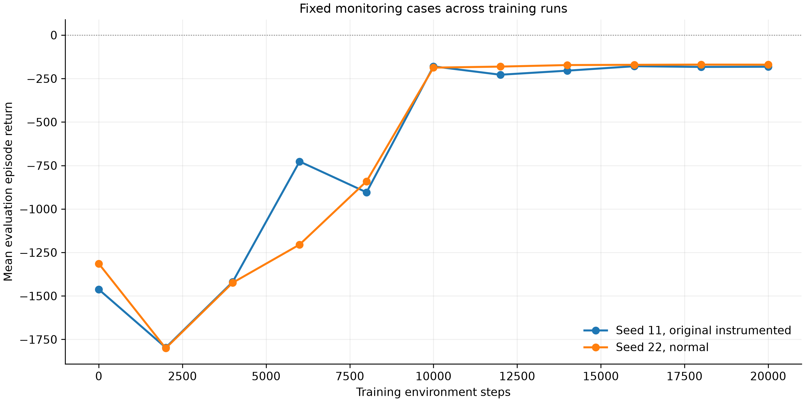
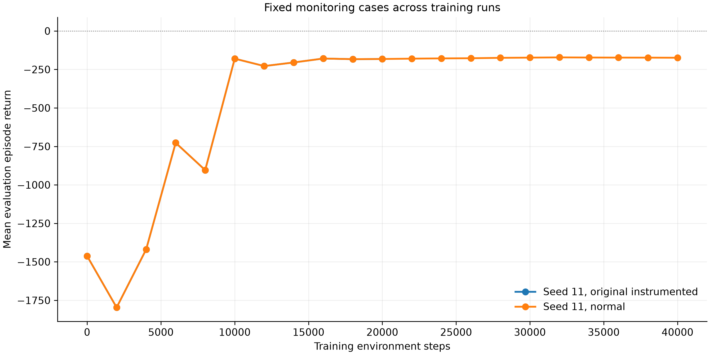

# TD3 on Pendulum-v1

Python/PyTorch implementation of Twin Delayed Deep Deterministic Policy Gradient (TD3) for pendulum swing-up and stabilization. The actor chooses continuous torque in [-2, 2] N m from cosine of angle, sine of angle, and angular velocity.

## Measured results

Noise-free evaluation uses the same five monitoring reset seeds (201-205). Return is the undiscounted episode reward; higher is better. Angle error is mean absolute angle during the final two seconds, averaged over those cases.

| Training seed | Training steps | Mean return | Final angle MAE |
| --- | ---: | ---: | ---: |
| 11, original | 20,000 | -182.03 | 10.59 degrees |
| 22 | 20,000 | -170.08 | 2.05 degrees |
| 11, longer budget | 40,000 | -173.87 | 10.80 degrees |

The original untrained actor returned -1462.57. Training improved swing-up and near-upright holding, but the original policy retained a stationary angle offset. Seed 22 reduced that offset. Longer training improved seed-11 return without improving final holding precision. These observations do not identify the offset's cause or establish broad reliability. There are **two independent training seeds**; rerunning seed 11 does not add a seed. Monitoring cases were inspected during development and are not an untouched test set.

Normal and diagnostic seed-11 runs matched exactly over **2,000 steps**, including final actor weights. Their logs reproduced the original prefix; complete 20,000-step mode equivalence was not tested. The 40,000-step run also matched the original episode/evaluation logs through 20,000 steps. Saved-policy replays matched final evaluation logs for all three main runs.

- [Seed comparison and validation report](comparisons/20261102T044528_950292Z/experiment_report.json)
- [Budget comparison report](comparisons/budget_seed11_40000_20261102/budget_comparison.json)
- [Original checkpoint, logs, and trajectories](runs/train_20261102T020701_889706Z/)
- [Seed-22 checkpoint and analysis](runs/repeat_20261102T044528_950292Z_seed22_normal/)
- [40,000-step checkpoint and analysis](runs/budget_seed11_40000_20261102/)





## Windows setup

Open the cloned repository in PowerShell. Keep an existing compatible virtual environment, or create one with Python 3.13:

```powershell
py -3.13 -m venv .venv
.\.venv\Scripts\python.exe -m pip install -r requirements.txt
```

In PyCharm, select the repository's `.venv\Scripts\python.exe`. Activation and a GPU are unnecessary. The recorded environment was Python 3.13.17, Gymnasium 1.4.0, NumPy 2.5.4, PyTorch 2.15.0+cpu, and Matplotlib 3.11.2.

## Run

```powershell
# Short normal/diagnostic seed-11 checks, then full 20,000-step seed 22.
.\.venv\Scripts\python.exe .\experiment.py --check-steps 2000

# Full 20,000-step validation of both modes, then seed 22.
.\.venv\Scripts\python.exe .\experiment.py

# Individual training runs (each starts fresh).
.\.venv\Scripts\python.exe .\train.py --seed 11 --steps 40000
.\.venv\Scripts\python.exe .\train.py --seed 11 --steps 20000 --diagnostics

# Replay the original checkpoint and regenerate analysis without opening windows.
.\.venv\Scripts\python.exe .\plot.py --no-show

# Analyze another run using its directory name under runs/.
.\.venv\Scripts\python.exe .\plot.py --run budget_seed11_40000_20261102 --no-show

# Baseline controls and numerical learning checks.
.\.venv\Scripts\python.exe .\baseline.py --diagnostics
```

The workflow creates unique directories under `runs/` and `comparisons/`, and stops if validation fails. Read `experiment_report.json` status before treating a run as complete. Evaluation episodes do not count toward training interactions. `--checks-only` omits the new seed; `--skip-checks` skips validation and should only be used after validation has passed.

## Code and protocol

| File | Purpose |
| --- | --- |
| `td3.py` | Replay buffer, actor, twin critics, target networks, delayed updates |
| `train.py` | Environment interaction, exploration, training, evaluation, logging |
| `baseline.py` | Zero/random controls and optional numerical diagnostics |
| `plot.py` | Saved-actor replay, physical metrics, trajectories, figures |
| `experiment.py` | Mode equivalence, reference reproduction, seed comparison |
| `budget_analysis.py` | Rebuild the included budget comparison from its saved runs |
| `requirements.txt` | Pinned dependencies |

The actor and critics use two 64-unit ReLU hidden layers. Training begins with 1,000 random-action steps, followed by one joint critic update per interaction from batches of 128. The actor and target networks update every second critic update. Discount is 0.99 and target interpolation is 0.005. Evaluation runs initially and every 2,000 training steps without exploration noise.

The target uses the smaller target-critic estimate and a clipped, noisy target action. Only true termination removes bootstrapping; time-limit truncation ends an episode but retains continuation value. Diagnostics add measurements without changing the learning schedule or consuming extra random draws.

Each main run includes settings, episode/evaluation CSVs, and `actor_final.pt`. The checkpoint saves only actor weights for playback, not the critics, optimizers, replay, or random state needed to resume training. Analysis includes trajectory CSVs, figures, and final-window physical metrics. The original archived files are retained; redundant analysis plots from the short validation runs are omitted from the commit.

The original run came from the [earlier implementation](https://github.com/B8Z/TD3/tree/8417ceeac2224d41539595cc8ebe44af8b5e4896). New logs distinguish losses used for optimization from the original post-update diagnostic columns; validation compares common behavior columns.

## AI disclosure

AI was used for help with research, revisions, and presentation generation.

## References

- [Gymnasium Pendulum-v1](https://gymnasium.farama.org/environments/classic_control/pendulum/)
- [Time-limit handling](https://gymnasium.farama.org/tutorials/gymnasium_basics/handling_time_limits/)
- [TD3 equations and pseudocode](https://spinningup.openai.com/en/latest/algorithms/td3.html)
